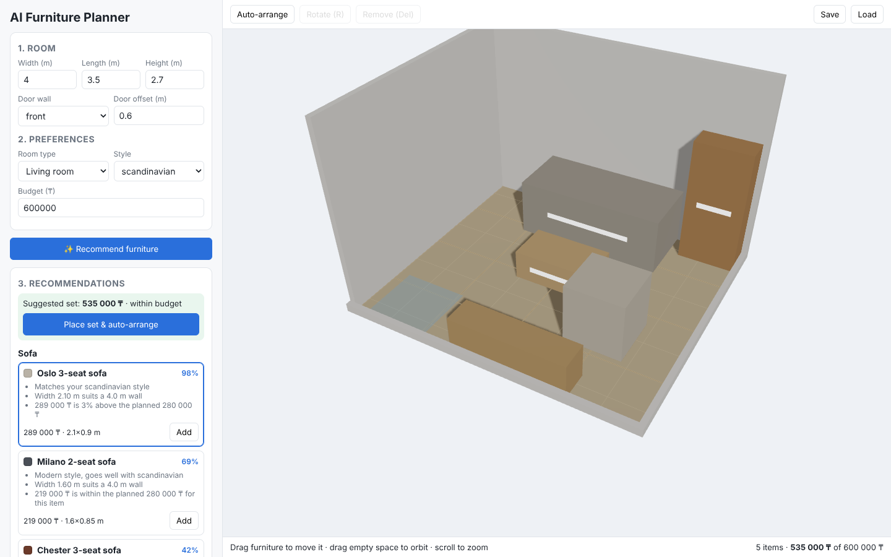

# Development of a Web-Based System for AI-Assisted Furniture Selection and 3D Room Planning

**Diploma Project** · Astana IT University · 2026–2027

A web application that recommends furniture fitting a user's room, style and budget, explains each recommendation, arranges the furniture automatically without collisions, and lets the user refine the result in an interactive 3D view.



## Problem statement

People who buy furniture, especially online, often cannot tell whether an item will fit their room, how to arrange it, or whether the whole set stays within budget. Existing tools either show 3D/AR views without helping to *choose* (Planner 5D, HomeByMe), lock users into one retailer (IKEA Kreativ), or generate attractive images that ignore real dimensions (generative "AI interior" apps). None explains *why* an item is suggested. See [existing systems comparison](docs/existing-systems.md) and [literature review](docs/literature-review.md).

## Target users

- **Primary:** people furnishing a flat or a room (students, young families, renters) without design experience.
- **Secondary:** furniture store consultants and interior designers working with clients.

Evidence and open assumptions: [docs/relevance-evidence.md](docs/relevance-evidence.md).

## Expected outcomes

1. A working web system: room setup, explained AI recommendations, automatic valid layout, 3D editing, cost summary, saved projects.
2. A recommendation engine and layout solver evaluated against baselines (constraint satisfaction, style precision, overlap/clearance rates, latency).
3. A usability study showing reduced time and higher decision confidence compared with manual planning (SUS ≥ 68).

Details: [proposal](docs/proposal.md) · [evaluation plan](docs/evaluation-plan.md).

## Team and responsibilities

| Member | Responsibility (proposed, see [project management](docs/project-management.md#3-allocation-of-responsibilities)) |
|--------|--------------------------------------------------|
| Tamerlan Yessimov | Backend, data model, database, repository & CI, technology comparison |
| Sultanbek Zhumagali | 3D frontend room editor, UX, existing systems, usability study |
| Muzaffar Kapezov | AI layer: recommendation engine, layout solver, benchmark; literature review |

**Supervisor:** Kashkimbayeva Nurzhamal

## Scope

**In scope:** rectangular rooms with doors; curated catalog (≥ 50 items by M2) with dimensions, styles and prices; rule-based recommendations with explanations; automatic layout with hard constraints (inside room, no overlap, door zone free); browser 3D editor; cost vs. budget; save/load.

**Out of scope:** photoreal rendering, AR on phones, room scanning, non-rectangular rooms (v1), checkout/payments, training large generative models.

## Current status (pre-defense 1, 24 October 2026)

| Deliverable | Status |
|-------------|--------|
| Proposal, requirements, technology comparison | Drafted ([proposal](docs/proposal.md), [requirements](docs/requirements.md), [technology comparison](docs/technology-comparison.md)) |
| Literature review (18 + 3 sources) | ✅ [docs/literature-review.md](docs/literature-review.md) |
| Existing systems (5 systems × 10 criteria) | ✅ draft; hands-on checks pending — [docs/existing-systems.md](docs/existing-systems.md) |
| Evidence of relevance | Protocol ready; **interviews to be conducted** — [docs/relevance-evidence.md](docs/relevance-evidence.md) |
| Architecture and diagrams (context, use case, component) | ✅ [docs/architecture.md](docs/architecture.md), sources in [docs/diagrams/src](docs/diagrams/src) |
| UX / prototype | ✅ runnable prototype — [docs/ux-prototype.md](docs/ux-prototype.md) |
| Verification and evaluation plan | ✅ [docs/evaluation-plan.md](docs/evaluation-plan.md) |
| Project management, risks, backlog | ✅ [docs/project-management.md](docs/project-management.md) |
| Supervisor feedback | Template ready — [docs/supervisor-feedback.md](docs/supervisor-feedback.md) |

**Prototype works today:** room setup, 3D view, drag/rotate/remove, explained recommendations (25-item demo catalog), auto-layout, live validation, cost summary, save/load (in memory). **Known limitations:** demo catalog with illustrative prices; boxes instead of 3D models; 90° rotations only; projects lost on backend restart; walkway clearance is a soft rule.

## Technologies

| Layer | Choice |
|-------|--------|
| Frontend | React 18, TypeScript, Vite, three.js via React Three Fiber + drei |
| Backend | Python 3.11+, FastAPI, Pydantic |
| Storage | PostgreSQL (+ pgvector) planned; JSON catalog and in-memory projects in the prototype |
| Interaction | REST/JSON, OpenAPI |
| Testing | pytest, vitest; Playwright planned for end-to-end |
| Diagrams | Mermaid (editable sources) |

Justification: [docs/technology-comparison.md](docs/technology-comparison.md).

## Links

- **YouTrack:** _TODO: add the YouTrack project URL_ (backlog import file: [project-management/youtrack-backlog.csv](project-management/youtrack-backlog.csv))
- **Documentation:** [docs/](docs)
- **Architecture:** [docs/architecture.md](docs/architecture.md)

## Repository structure

```
backend/            FastAPI service
  app/              API, recommender, layout solver, geometry, catalog
  data/             demo furniture catalog (JSON)
  tests/            pytest tests
frontend/           React + three.js 3D editor
  src/components/   UI and 3D scene
  src/lib/          API client, types, geometry (+ vitest tests)
docs/               proposal, requirements, reviews, comparisons, plans
  diagrams/src/     editable Mermaid sources
  diagrams/export/  SVG / PNG exports
  assets/           screenshots
project-management/ YouTrack backlog import
.env.example        configuration example (placeholders only)
```

## Setup and running

Requirements: Python 3.11+, Node.js 20+.

```bash
# 1. Backend  (http://localhost:8000, API docs at /docs)
cd backend
python -m venv .venv && source .venv/bin/activate   # Windows: .venv\Scripts\activate
pip install -r requirements-dev.txt
uvicorn app.main:app --reload

# 2. Frontend (http://localhost:5173), in a second terminal
cd frontend
npm install
npm run dev
```

The frontend dev server proxies `/api` to the backend. Configuration options are listed in [.env.example](.env.example).

## Testing

```bash
cd backend && pytest          # 35 tests: geometry, recommender, layout, API
cd frontend && npm test       # client geometry tests
cd frontend && npm run build  # type check + production build
```

## Contributing

- Branch per YouTrack task: `DIP-<n>-short-name`; commit messages start with `DIP-<n>:`.
- Open a pull request explaining the change, the task, and how it was checked; another team member reviews before merging into `main`.
- Never commit secrets or personal data: use `.env` (ignored) based on `.env.example`.
- Pre-defense submissions are tagged `pre-defense-1`, `pre-defense-2`, `final-pre-defense`.
