# Architecture Description

**Task:** DIP-8 · **Status:** draft for pre-defense 1 (24 October 2026)

Diagram sources (editable, [Mermaid](https://mermaid.js.org/)) are in [`diagrams/src/`](diagrams/src); readable exports (SVG + PNG) in [`diagrams/export/`](diagrams/export). To regenerate after editing: `npx -p @mermaid-js/mermaid-cli mmdc -i docs/diagrams/src/<name>.mmd -o docs/diagrams/export/<name>.svg`. They can also be edited in the browser at https://mermaid.live.

## 1. Architectural style

Arca is a **distributed web application** with three runtime services and a data pipeline:

- **Web client (browser):** React + TypeScript single-page application; 3D rendering with three.js through React Three Fiber. Holds the editing state and gives instant feedback while dragging (client-side collision checks).
- **Core API (Go, net/http, hexagonal architecture):** catalogue search, users, rooms and projects, and the **layout module** (placement validation with AABB/OBB collision checks, walkways, doors and windows; constraint-based automatic arrangement). Authoritative for all validation. Documented by an OpenAPI contract.
- **ML service (Python, FastAPI, PyTorch, Hugging Face):** CLIP image/text embeddings, style-similarity search, ranking under room-size, budget and already-chosen-furniture constraints, parsing of natural-language requests into filters. Called only by the core API; if it is unavailable, the core API falls back to the baseline ranking (filter by category and price).
- **Catalogue pipeline (Python):** parsers for Kazakhstan furniture stores (e.g. mebel.kz) that respect robots.txt and rate limits, plus normalisation of dimensions, materials, colour and price.
- **Storage:** PostgreSQL + pgvector (users, rooms, projects, catalogue, embeddings), Redis (query cache), MinIO / S3 (images, GLB models). See [database-schema.md](database-schema.md).
- **Interaction:** REST/JSON over HTTPS between client and core API; internal REST/JSON between core API and ML service (see `technology-comparison.md` §5).
- **Infrastructure:** Docker Compose for all services, GitHub Actions CI, demo stand.

### Prototype vs. target architecture

The pre-defense 1 prototype (`backend/`, `frontend/`) deliberately runs as **one Python service** so that the recommendation and layout ideas could be tried end to end before the services are split:

| Prototype module (`backend/app/`) | Target location |
|-----------------------------------|-----------------|
| `recommender.py` | ML service (rule-based scorer becomes the baseline + feature set for the CLIP ranker) |
| `layout.py`, `geometry.py` | Core API layout module (Go) — DIP-15, DIP-19 |
| `catalog.py`, `data/catalog.json` | Core API catalogue service + PostgreSQL, filled by the parsers — DIP-25, DIP-26 |
| project endpoints in `main.py` | Core API projects service + PostgreSQL — DIP-17 |

The REST contract of the prototype (`/api/catalog`, `/api/recommendations`, `/api/layout`, `/api/validate`, `/api/projects`) is kept, so the web client does not change when the backend is replaced.

## 2. System context



| Actor / system | Interaction |
|----------------|-------------|
| Home user | Main user. Enters room and preferences, receives recommendations, arranges furniture in 3D. |
| Interior designer / seller | Uses the same functions with a client. |
| Catalog administrator | Runs catalogue imports, fixes data, uploads 3D models. |
| Kazakhstan online furniture stores (external) | Source of product data (dimensions, materials, colour, prices, images), collected by our parsers. |
| 3D model sources (external) | GLB models from retailers or CC0 libraries; licence recorded per model. |
| Open-source ML models (external) | CLIP-family model weights from Hugging Face, downloaded once and run inside the ML service. |
| LLM API (external, optional) | Parses free-text requests into structured filters when the local parser is not enough (DIP-29). The system works fully without it. |

## 3. Use cases



| ID | Use case | Actor | Requirement | Prototype status |
|----|----------|-------|-------------|------------------|
| UC-01 | Set up room (dimensions, doors) | User | FR-01 | ✅ |
| UC-02 | View and navigate the room in 3D | User | FR-02 | ✅ |
| UC-03 | Browse and filter catalog | User | FR-04 | ✅ (category filter; API supports style and price) |
| UC-04 | Get AI furniture recommendations | User | FR-05 | ✅ rule-based v1 |
| UC-05 | Place / move / rotate / remove furniture | User | FR-03 | ✅ |
| UC-06 | Generate automatic layout | User | FR-06 | ✅ rule-based v1 |
| UC-07 | Validate layout (collisions, bounds, door) | System (included) | FR-07 | ✅ walkway clearance is soft in v1 |
| UC-08 | View cost summary vs. budget | User | FR-09 | ✅ |
| UC-09 | Save / load project | User | FR-08 | ✅ in-memory (DIP-17 adds DB) |
| UC-10 | Describe wishes in natural language | User, LLM API | (Could) | ⏳ DIP-24 |
| UC-11 | Manage catalog | Admin | FR-29, FR-31 | ⏳ JSON file for now |
| UC-12 | Find items similar to chosen furniture | User | FR-36 | ⏳ needs CLIP embeddings (DIP-28) |

### Main scenario: UC-04 + UC-06 "Furnish my living room"

1. User enters room 4.0 × 3.5 m, door on the front wall, style *Scandinavian*, budget 600 000 ₸.
2. User presses **Recommend furniture** → `POST /api/recommendations`.
3. Backend filters the catalog by hard constraints (fits room, ≤ budget), scores the rest (style 50 %, size 30 %, price 20 %), returns top-3 per category with reasons, and a bundle that fits the budget.
4. User presses **Place set & auto-arrange** → `POST /api/layout` with the bundle.
5. Backend places items greedily (sofa → TV stand opposite → coffee table in front of sofa → armchair facing table → bookshelf in a corner), never violating hard constraints; returns placements and any items that did not fit.
6. Frontend renders the layout; user drags/rotates items; invalid positions turn red instantly; cost summary updates.
7. User saves the project → `POST /api/projects`.

**Alternative flows:** 3a — nothing in a category fits → category shown as empty with a message; 3b — budget cannot cover a full set → bundle marked "over budget"; 5a — no valid position for an item → listed as "not enough free space".

## 4. Components



| Component | Responsibility | Owner | Prototype code |
|-----------|----------------|-------|----------------|
| Pages | Catalogue, product card, account with projects | Muzaffar | `frontend/src/components/CatalogPanel.tsx` (catalogue list) |
| 3D Room Editor | Room, doors/windows, drag/rotate, wall snapping, top-down and free camera, invalid highlight | Muzaffar | `frontend/src/components/Scene.tsx` |
| Asset loader | GLB + Draco, LOD, parametric models from dimensions | Muzaffar | boxes from dimensions in `Scene.tsx` |
| State store / API client | Room, placed items, selection; typed REST calls | Muzaffar | `frontend/src/App.tsx`, `src/lib/api.ts`, `src/lib/geometry.ts` |
| HTTP adapter | REST handlers, auth, OpenAPI contract | Sultanbek | `backend/app/main.py` |
| Catalogue service | Search and filters over PostgreSQL (+ Redis cache) | Sultanbek | `backend/app/catalog.py` |
| Projects service | Users, rooms, projects, placements | Sultanbek | in-memory store in `main.py` |
| Layout module | Collision checks (AABB/OBB), walkways, doors, windows; constraint-based auto-layout | Sultanbek | `backend/app/geometry.py`, `layout.py` |
| Recommendation port | Calls the ML service; baseline fallback | Sultanbek | — |
| Catalogue pipeline | Store parsers, normalisation, deduplication | Sultanbek | — (DIP-25) |
| ML API / Ranker | Ranking under room, budget and chosen-furniture constraints; explanations | Tamerlan | `backend/app/recommender.py` (rule-based baseline) |
| Embedding module | CLIP image and text vectors stored in pgvector | Tamerlan | — (DIP-28) |
| Query parser | Free text → structured filters | Tamerlan | — (DIP-29) |

## 5. Data model

The full draft schema is in [database-schema.md](database-schema.md) (ER diagram with editable source). Core entities:

```
FurnitureItem(id, store, category, external_id, name, width_cm, depth_cm, height_cm, price_kzt, material, color, styles[], images[], model, embedding)
Room(id, user, room_type, floor_polygon, height_cm, openings[Door|Window])
Project(id, user, room, styles, budget_kzt, placements[Placement(item, x_cm, z_cm, rotation_deg, locked)])
```

Coordinates: floor in the room's plane, x to the right and z towards the viewer; rotation 0° means the item's front faces +z, matching three.js `rotation.y`. The prototype uses metres; the database stores centimetres.

## 6. API (prototype contract, kept by the core API)

| Method & path | Purpose | Requirement |
|---------------|---------|-------------|
| `GET /api/health` | Liveness | — |
| `GET /api/catalog?category=&style=&max_price=` | Filtered catalog | FR-04 |
| `GET /api/catalog/categories` | Category list | FR-04 |
| `GET /api/catalog/{id}` | One item | FR-04 |
| `POST /api/recommendations` | Ranked, explained recommendations + budget bundle | FR-05, FR-09 |
| `POST /api/layout` | Automatic layout | FR-06, FR-07 |
| `POST /api/validate` | Validate a user's layout | FR-07 |
| `POST /api/projects`, `GET/PUT /api/projects/{id}` | Save / load | FR-08 |

Example request/response pairs are in [`ux-prototype.md`](ux-prototype.md#api-examples).

## 7. Consistency check (requirements ↔ use cases ↔ components)

| Requirement | Use case | Components |
|-------------|----------|------------|
| FR-01 | UC-01 | RoomForm, Room model |
| FR-02 | UC-02 | 3D Room Editor |
| FR-03 | UC-05 | 3D Room Editor, state store |
| FR-04 | UC-03 | CatalogPanel, Catalog service |
| FR-05 | UC-04 | RecommendationPanel, Recommendation engine |
| FR-06 | UC-06 | Layout solver |
| FR-07 | UC-07 | Geometry & validation (backend), client geometry |
| FR-08 | UC-09 | Project service |
| FR-09 | UC-08 | CostSummary, Recommendation engine (bundle) |

## 8. Architectural decisions (summary)

| ADR | Decision | Reason | Alternatives (see `technology-comparison.md`) |
|-----|----------|--------|-------------------------------------|
| ADR-1 | Split into Go core API and Python ML service | Performance targets (search p95 < 300 ms, CPU-bound layout checks); ML needs Python; team skills | FastAPI monolith, Node API |
| ADR-2 | Rule-based baseline first; CLIP-based ranker replaces it behind the same interface and is compared to it | No user history (cold start); a baseline is required for the evaluation | Collaborative filtering, LLM-only |
| ADR-3 | Hard constraints enforced by a deterministic solver, never by the AI proposal itself | Generative methods do not guarantee validity | Trust model output, post-filter |
| ADR-4 | Validation duplicated client-side for instant feedback; backend is authoritative | Dragging needs < 16 ms feedback | Server-only validation |
| ADR-5 | Axis-aligned boxes (AABB) with 90° rotation in v1, oriented boxes (OBB) for free rotation later | Simpler, exact geometry first; OBB when free rotation is added | Mesh-level collision |
