# Database Schema (draft)

**Task:** DIP-27 · **Owner:** Sultanbek Zhumagali · **Status:** draft for pre-defense 1 (24 October 2026)

PostgreSQL 16 with the `pgvector` extension. Editable source: [`diagrams/src/04-database-schema.mmd`](diagrams/src/04-database-schema.mmd); export: [`diagrams/export/04-database-schema.svg`](diagrams/export/04-database-schema.svg).

## Design notes

| Decision | Reason | Requirement |
|----------|--------|-------------|
| All dimensions stored as integer **centimetres**, prices as integer **KZT** | Exact comparisons in filters and layout checks, no floating-point drift | FR-28, FR-31 |
| `furniture_items` keyed by `(store_id, external_id)` (unique) | Re-running a parser updates items instead of duplicating them | FR-31 |
| `scraped_at` and `import_runs` | Prices are dated; each import is auditable (added / updated / rejected rows) | FR-31 |
| `item_models.source` = `seller` / `cc0` / `parametric` | Items without a seller model still get a parametric model built from dimensions | FR-57 |
| `item_embeddings` with two `vector(512)` columns (image, text) and an HNSW index | Style-similarity search in one SQL query together with hard filters (size, price) | FR-05, NFR-36 |
| `rooms.floor_polygon` as `jsonb` | Rectangular and L-shaped rooms without extra tables; validated by the API | FR-01, FR-15 |
| `room_openings` for doors and windows | Layout module keeps door swing and window fronts clear | FR-16, FR-39 |
| `placements.locked` | Re-arrange the rest while keeping locked items | FR-44 |
| `categories.default_clearance_cm`, `against_wall` | Placement metadata read by the layout module | FR-30 |
| Images and GLB files in MinIO, only keys in the database | Keeps the database small; files served directly to the browser | NFR-33 |

## Main indexes

- `furniture_items (category_id, price_kzt)`, `(width_cm, depth_cm)` for catalogue filters (NFR-35: search p95 < 300 ms).
- `furniture_items` full-text index on `name, description` (Russian and English configurations).
- `item_embeddings` HNSW indexes on `image_vec` and `text_vec` (cosine distance).
- `projects (user_id, updated_at desc)` for the project list.

## Mapping to the prototype

The pre-defense 1 prototype stores a 25-item demo catalogue in `backend/data/catalog.json` and projects in memory. Its fields map one-to-one to `furniture_items` (metres → centimetres) and `placements`.
