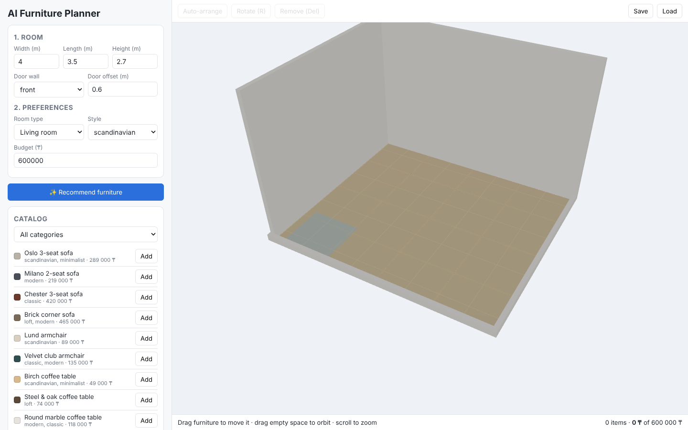
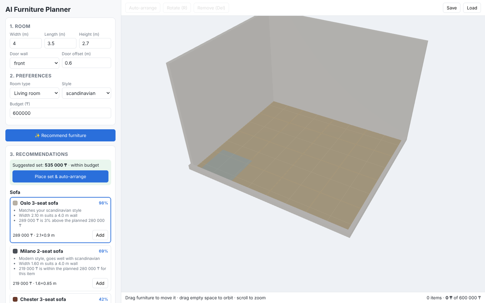
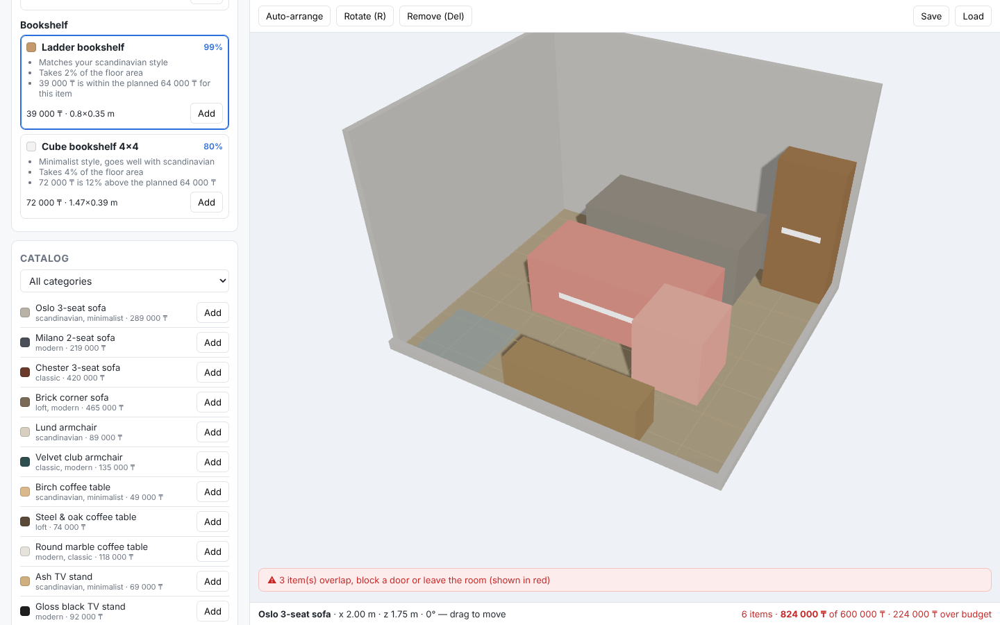

# UX and Prototype

**Task:** DIP-9 · **Status:** working prototype for pre-defense 1 (24 October 2026)

The prototype is runnable code, not only mockups: see the README for how to start it. Screenshots below were taken from the running prototype (Chrome, 1440×900). Furniture is drawn as scaled boxes with a white strip marking the front; real glTF models come with DIP-18.

## Key user scenarios

### S1. Set up the room (UC-01, UC-02)

The user enters width, length and height, chooses the door wall and position, and sees the empty room to scale. The blue square on the floor is the door swing zone that must stay free.



### S2. Get explained recommendations (UC-04)

After choosing room type, style and budget, **Recommend furniture** returns the top options per category. Each card shows a match score and three reasons (style, size, price). Cards outlined in blue form the suggested set, which fits the budget.



### S3. Auto-arrange (UC-06)

**Place set & auto-arrange** places the suggested set: sofa against a long wall facing the room, TV stand on the opposite wall, coffee table in front of the sofa, armchair facing the table, bookshelf near a corner, door zone kept free. The cost summary at the bottom right updates.


### S4. Edit and validate (UC-05, UC-07, UC-08)

The user drags items on the floor (5 cm snapping), rotates with **R**, and removes with **Del**. Any item that overlaps another, leaves the room or blocks the door turns red and a warning appears. If the total exceeds the budget, the cost summary turns red. Here a second sofa was added on top of the layout:



### S5. Save and load (UC-09)

**Save** stores the project and shows its id; **Load** asks for an id and restores the room, items, style and budget.

## Interaction design decisions

| Decision | Reason |
|----------|--------|
| Left panel follows the task order: 1. Room → 2. Preferences → 3. Recommendations → Catalog | Matches the user's mental model found in the literature (size first, then style, then budget) |
| Reasons shown on every card | Explainability is the main gap in existing systems (see `existing-systems.md`, C7) |
| Instant red highlight instead of blocking moves | Users can try positions freely; the system never silently "fixes" their choice |
| Front and right walls drawn low | Keeps the camera view unobstructed without a separate "cut-away" mode |
| Auto-arrange works on whatever is placed, not only the suggested set | Users who pick items manually also benefit |

## Planned improvements (after user feedback)

- Top-down 2D plan view toggle with dimensions.
- Real 3D models and thumbnails.
- Text request ("cosy reading corner by the window") → constraints (DIP-24).
- Windows, radiators and other fixed elements.

## API examples

Real responses from the running backend (abridged). Full interactive documentation: http://localhost:8000/docs.

### Recommendations

```http
POST /api/recommendations
Content-Type: application/json

{
  "room": {"width": 4, "length": 3.5, "doors": [{"wall": "front", "offset": 0.6}]},
  "room_type": "living_room",
  "style": "scandinavian",
  "budget": 600000,
  "categories": ["sofa", "coffee_table"],
  "top_k": 2
}
```

```json
{
  "categories": [
    {
      "category": "sofa",
      "options": [
        {
          "item": {"id": "sofa-oslo-3", "name": "Oslo 3-seat sofa", "width": 2.1, "depth": 0.9, "price": 289000, "styles": ["scandinavian", "minimalist"]},
          "score": 0.985,
          "reasons": [
            "Matches your scandinavian style",
            "Width 2.10 m suits a 4.0 m wall",
            "289 000 ₸ is within the planned 488 372 ₸ for this item"
          ]
        },
        {
          "item": {"id": "sofa-milano-2", "name": "Milano 2-seat sofa", "price": 219000, "styles": ["modern"]},
          "score": 0.69,
          "reasons": ["Modern style, goes well with scandinavian", "Width 1.60 m suits a 4.0 m wall", "219 000 ₸ is within the planned 488 372 ₸ for this item"]
        }
      ]
    },
    {"category": "coffee_table", "options": ["…"]}
  ],
  "bundle": ["sofa-oslo-3", "coffee-birch"],
  "bundle_price": 338000,
  "within_budget": true
}
```

### Automatic layout

```http
POST /api/layout
Content-Type: application/json

{
  "room": {"width": 4, "length": 3.5, "doors": [{"wall": "front", "offset": 0.6}]},
  "item_ids": ["sofa-oslo-3", "coffee-birch", "tv-ash"]
}
```

```json
{
  "placements": [
    {"item_id": "sofa-oslo-3", "x": 2.0, "z": 0.45, "rotation": 0},
    {"item_id": "tv-ash", "x": 2.3, "z": 3.3, "rotation": 180},
    {"item_id": "coffee-birch", "x": 2.0, "z": 1.6, "rotation": 0}
  ],
  "unplaced": [],
  "violations": []
}
```

### Validation error example

```http
POST /api/recommendations
{"room": {"width": 50, "length": 3}, "style": "modern", "budget": 1000}
```

→ `422 Unprocessable Entity` with a field-level message (`room.width: Input should be less than or equal to 10`).
